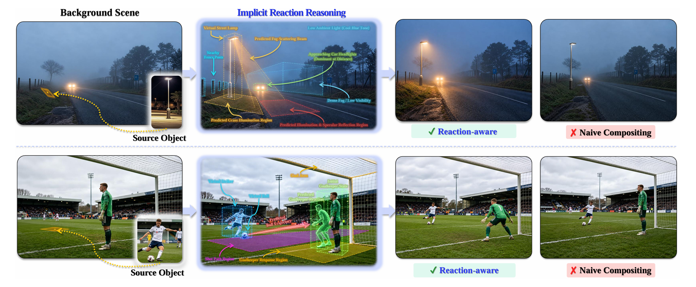
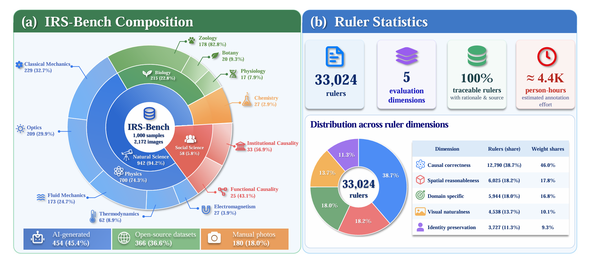
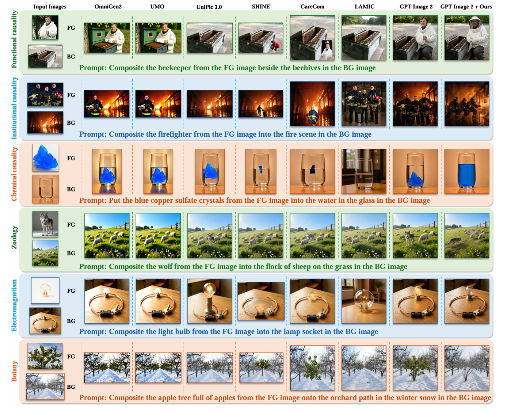
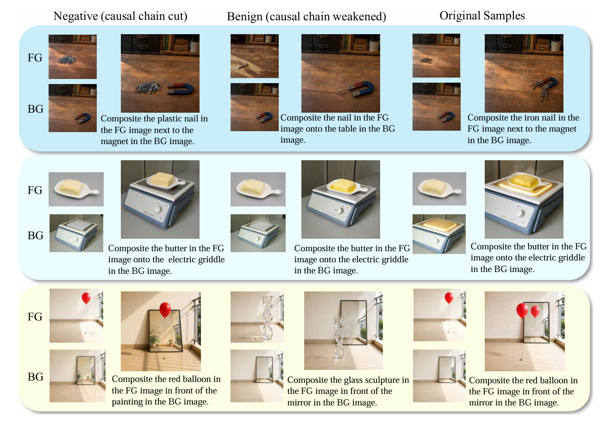

<div align="center">

# When Worlds Meet

### Benchmarking Implicit Causal Reasoning with IRS-Bench

[]()
[]()
[]()
[]()

**1,000 pairs · 11 leaf tasks · 5 causal dimensions · 172 photographic GT · 33,024 binary rulers**

</div>

<!-- 图位：导出论文原图到 assets/ 即可
     fig1_teaser.png  fig2_framework.png  fig3_distribution.png
     fig4_qualitative.png  fig5_ablation.png -->

## News

- **[2026.09]** Submitted to **ICLR 2027** (under review).
- **[Soon]** `IRS-1k` dataset · `ME-Ruler` annotations · evaluation code · Reaction-Graph pipeline.

## 🌞 Abstract

An image captures a partial snapshot of a local world. Combining foreground and background snapshots therefore requires more than harmonizing pixels: the merged scene must realize the state changes and scene effects licensed by their interaction. Existing benchmarks for image composition primarily measure perceptual quality, identity preservation, and spatial alignment, leaving this **merge-and-reaction problem** untested.

We formulate it as **image-conditioned implicit causal reasoning** and introduce **IRS-Bench**. Each instance provides a foreground image `F`, a background image `B`, and an instruction `q` specifying the entities and their placement, while withholding the governing relation and its consequence. To accept valid alternatives, IRS-Bench distinguishes **deterministic** interactions with one admissible state from **intentional** interactions with an admissible set. The benchmark contains **1,000 pairs** across **eleven leaf tasks** and **five causal mechanisms**, each with a governing rule, admissible outcomes, and weighted binary visual checks; **172 items** also provide photographic post-interaction references.

Under the **ME-Ruler** score, the strongest non-ReactionGraph baseline obtains **61.1** and **71.6** under GPT-5.6SOL and Qwen-3.8-27B across 18 systems; a training-free **Reaction-Graph** reference pipeline obtains **77.2** and **88.8**. These results show that **perceptual coherence and causal faithfulness are distinct capabilities**.



## 📐 The task

`(B, F, q)` — `q` names **entities and placement only**, never the relation or its consequence.

- **Identity lock** — the inserted entity keeps its identity; nothing new enters.
- **State freedom** — the merge may rewrite *how* an entity is, never *which* entity it is.
- **Regime-aware** — `DET` (727) admits one state, `INT` (273) admits a set.
- **Reference-independent** — any composite satisfying the annotated relation is admissible; a GT image is one realization, not the definition.



## 📖 IRS-Bench

| | |
| --- | --- |
| Instances | **1,000** pairs |
| Leaf tasks / causal dimensions | **11** / **5** (physical, biological, chemical, institutional, functional) |
| Regimes | **727** deterministic · **273** intentional |
| Sources | **454** AI-generated · **366** web · **180** author-photographed |
| Photographic GT | **172** items |
| Controlled variants | causal-condition **removed** · **weakened** |
| Rulers | **33,024** binary questions |

Instances are classified by the **relation they test**, not the objects they contain.

```
Physical        Classical Mechanics 229 · Optics 209 · Fluid Dynamics 173
                Thermodynamics 62 · Electromagnetism 27
Biological      Zoology 178 · Botany 20 · Physiology 17
Chemical        Chemical Reaction 27
Institutional   Institutional Rule Response 33
Functional      Functional Interaction 25
```

A pair is kept only when the foreground is unambiguously identifiable, the background supports a definite interaction, and **the required reaction is absent from both inputs** — so an item cannot be answered by copying evidence.

## 🧾 ME-Ruler

Weighted binary questions over five axes — **causal correctness · domain specificity · visual naturalness · spatial reasonableness · identity preservation**. Importances are normalized per instance, so each contributes exactly **100** weight.

```
S_m = (1/N) Σ_i Σ_j  w_ij · 1[ J_m(Î_i , r_ij) = "yes" ]
```

Judges run at temperature 0: **GPT-5.6SOL** and **Qwen-3.8-27B**, with Claude Sonnet 5 as a third evaluator. **Scores are evaluator-specific.**

## 🔧 Reaction Graph

A **training-free** diagnostic pipeline that makes the inferred interaction explicit *before* realizing the image — one pass per item, no repair or reranking:

```
M⁽⁰⁾ = 𝒢_comp(B,F,q)      neutral seed
H    = Φ_infer(B,F,M⁽⁰⁾,q)  reaction graph (acyclic, provenance-carrying)
P    = Ψ_comp(H,B,F,q)      typed constraints: position / state / effect / identity
Î    = Θ_real(M⁽⁰⁾,B,F,P)   single-edit realization
```

## 🍭 Results

| System | GPT-5.6SOL | Qwen-3.8-27B |
| --- | --- | --- |
| Copy-paste *(lower bound)* | 36.4 | 47.0 |
| Best existing system | 61.1 | 71.6 |
| **Reaction Graph (ours)** | **77.2** | **88.8** |

Same systems, appearance metrics barely move: FID 113.9–147.9 · LPIPS 0.50–0.69 · CLIP-I 0.80–0.88. Copy-paste even records the **lowest LPIPS**. A suite that ranks these systems within a hair on appearance separates them by **39 ME-Ruler points**.



**Controlled variants** — negative items cut a required causal condition, benign items weaken it.

| Set | Ours | Naive | Gain |
| --- | --- | --- | --- |
| Negative | **84.00** | 67.57 | **+16.43** |
| Benign | **75.07** | 68.15 | +6.92 |

The gain on negatives is **2.4×** the gain on benign → the pipeline detects **broken causal conditions**, not memorized co-occurrence.



**Human study** — 22 scenarios · 21 systems · 4 annotators.

| Method | SRCC ↑ | KRCC ↑ | RankMAE ↓ |
| --- | --- | --- | --- |
| **ME-Ruler (GPT-5.6 Sol)** | **0.877** | 0.714 | 2.29 |
| ME-Ruler (Qwen-3.8-27B) | 0.858 | 0.705 | 2.19 |
| CompBench | 0.598 | 0.438 | 4.38 |
| Share-CoT | 0.442 | 0.333 | 4.48 |

## 🔨 Usage

```python
inst = load_instance("自然科学/物理因果/经典力学/人工实拍/16")
score = me_ruler(composite, inst, judge="GPT-5.6SOL")   # {"overall", "by_axis", "verdicts"}
```

⚠️ Never feed `relation` / `admissible` / `effects` to the evaluated system. Report **per task**, **per axis**, and name the **judge**.

## 📌 Scope

Coverage is broad but **not balanced** (mechanics / optics / zoology dominate). **172 / 1,000** items have a photographic target. The 100 multi-foreground items and video examples are **qualitative transfer studies**, excluded from the benchmark score.

## ⭐ Citation

```bibtex
@article{irsbench2027,
  title  = {When Worlds Meet: Benchmarking Implicit Causal Reasoning with IRS-Bench},
  author = {Anonymous Authors},
  year   = {2026}
}
```

## 🎺 Statement

No personal attributes or private communications are collected. Third-party imagery is not relicensed beyond its source permissions; a per-item provenance manifest ships with the release. Contact **<TODO: email>** for removal requests.
